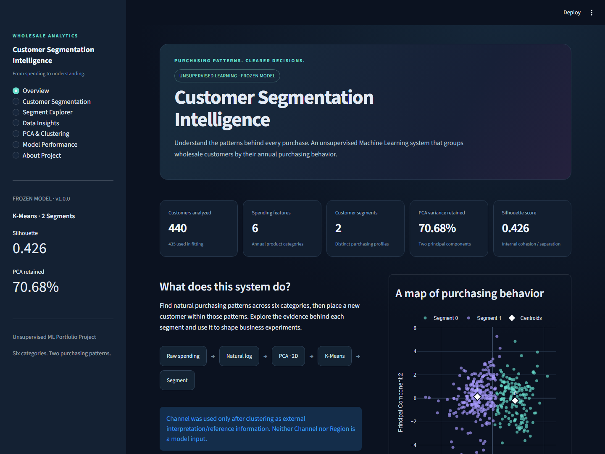
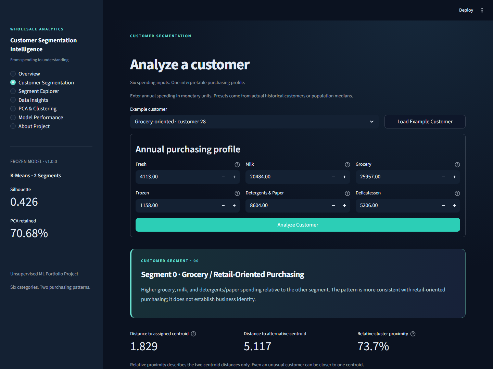
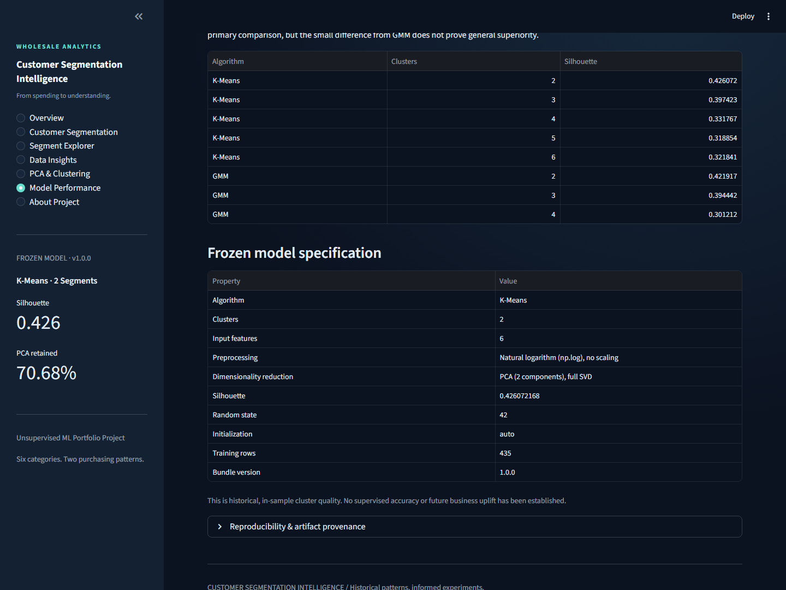

# Customer Segmentation Intelligence ◈

**Unsupervised machine learning · Wholesale customer analytics · PCA + K-Means · Interactive Streamlit dashboard**

Turn historical wholesale spending data into **interpretable purchasing segments** and explore what distinguishes them. This portfolio project combines a reproducible, audited clustering notebook with a frozen inference pipeline and a seven-page Streamlit application.



> **Educational analytics demo:** Segments are inferred from historical spending and are not verified customer identities, forward-looking demand forecasts, or evidence that an intervention will improve business outcomes.

## Results at a glance

| Metric | Verified project result |
|:--|--:|
| Customers in source dataset | **440** |
| Customers used for clustering | **435** |
| Spending variables | **6** |
| Final model | **K-Means, k=2** |
| Silhouette score | **0.426072** |
| Variance retained by first two PCs | **70.6817%** |
| Segment sizes | **175 / 260** |
| Missing values / duplicate rows | **0 / 0** |

These results are documented in [`customer_segments_completed.ipynb`](customer_segments_completed.ipynb), [`project_audit.md`](project_audit.md), and the versioned model artifact. **A silhouette score is not prediction accuracy**; the clustering has moderate overlap.

## Explore the app

The seven dashboard views let a reviewer explore real data, not mock outputs:

1. **Overview** — dataset summary, validated metrics, PCA map, and workflow.
2. **Customer Segmentation** — enter six spending values or load real example customers, then explore the assigned cluster, distances, and a spending profile.
3. **Segment Explorer** — representative spending patterns and external Channel composition.
4. **Data Insights** — missing values, skew, correlations, outliers, and distributions.
5. **PCA & Clustering** — explained variance, PCA loadings, and two-dimensional clustering structure.
6. **Model Performance** — K-Means vs Gaussian Mixture Model silhouettes and rationale for selecting k=2.
7. **About Project** — reproducibility, business use cases, and limitations.

| Customer analysis | Performance analysis |
|:--:|:--:|
|  |  |

> **Live demo:** Publish `app.py` via [Streamlit Community Cloud](https://share.streamlit.io/) after pushing the repository. Add the deployed URL here once verified.

## Machine learning workflow


Training excludes 5 extreme observations based on a **predefined multi-feature Tukey rule**; 435 samples are clustered. **Region** and **Channel** are not used to fit the model. The external Channel comparison is applied only *after* the spending-based labels and segment descriptions are frozen. New-customer inference validates positive values, applies the saved log → PCA → K-Means pipeline, and never retrains automatically.

### Interpreting the segments

| Segment | Customers | Behavioral description | External Channel composition |
|:--|--:|:--|:--|
| 0 | 175 | Grocery / retail-oriented purchases | 135 Retail, 40 HoReCa |
| 1 | 260 | Relatively fresh / frozen / food-service-oriented purchases | 254 HoReCa, 6 Retail |

Descriptions are **hypotheses based on relative spending**, not categorical labels or confirmed business identities. Segment numbers are arbitrary; don't interpret centroid proximity as calibrated probability.

## Quick start

**Recommended runtime:** Python **3.11** with pinned packages (the project was originally validated on Python 3.10.11).

```bash
git clone https://github.com/mohab-yasser/customer-segmentation-intelligence.git
cd customer-segmentation-intelligence
python -m venv .venv
```

On **Windows PowerShell**:

```powershell
.venv\Scripts\Activate.ps1
python -m pip install -r requirements.txt
streamlit run app.py
```

On **macOS/Linux**:

```bash
source .venv/bin/activate
python -m pip install -r requirements.txt
streamlit run app.py
```

The app loads `artifacts/customer_segmentation_bundle.joblib` and checks its scikit-learn version and the SHA-256 of `customers.csv`. **Do not load untrusted `.joblib` files**, which use Python pickle serialization. The model artifact is shipped so the app **does not train at startup**.

### Reproduce the analysis / run tests

```bash
# Open customer_segments_completed.ipynb in VS Code or an installed Jupyter environment.
# Or inspect the included static report: customer_segments_completed.html
# Regenerate the bundle offline in the pinned environment (optional)
python export_model.py

# Run tests from the repository root
python -m unittest discover -s tests -v
```

The export script asserts consistency with the saved notebook outputs and refuses to overwrite the artifact when reference results drift. Avoid rerunning the exporter against changed data without reviewing the documented expected outputs.

## GitHub repository structure

```text
customer-segmentation-intelligence/
├── app.py                           # Streamlit entry point
├── src/                             # Validated loading, inference, charts and pages
├── artifacts/
│   └── customer_segmentation_bundle.joblib
├── assets/screenshots/              # Real app captures, desktop and mobile
├── .streamlit/config.toml           # Dark theme / web settings
├── customers.csv                    # Historical wholesale customers dataset
├── customer_segments_completed.ipynb # Executed analysis
├── customer_segments_completed.html  # Static analysis report
├── customer_segments.ipynb          # Original assignment template (reference)
├── export_model.py                  # Offline, assertion-checked exporter
├── tests/                            # Unit, AppTest and optional browser smoke tests
├── visuals.py                       # Notebook visualizations
├── project_audit.md                 # Verification notes and known limitations
├── README_COMPLETED.md              # In-depth analysis guide
├── docs/ORIGINAL_ASSIGNMENT.md      # Historical instructor documentation
├── .github/workflows/ci.yml         # Automated checks on pushes and PRs
└── requirements.txt                 # Pinned environment
```

## Deploy to Streamlit Community Cloud

1. Push this project to a public GitHub repository.
2. Open [Streamlit Community Cloud](https://share.streamlit.io/) and choose **Create app** → **Deploy from GitHub**.
3. Select the repository and `main` branch; set **Main file path** to `app.py`.
4. Choose a compatible Python version (Python 3.11 recommended) and deploy. No environment secrets are required.
5. Verify all seven pages, then test notebook reference customers: **3 → segment 1**, **28 → segment 0**, **34 → segment 1**.
6. Add the actual URL to this README only after it loads successfully.

## Evaluation and limitations

- **Dataset:** 440 historical wholesale customers, sourced from the [UCI Wholesale Customers dataset](https://archive.ics.uci.edu/dataset/292/wholesale+customers). Monetary units are dataset-specific; don't assume a currency.
- **PCA trade-off:** The two plotted PCs retain ~70.68% of variance; ~29.32% is not captured.
- **Cluster structure:** Two groups are moderately separated, with overlapping behaviors; this is not a customer identity classifier.
- **Sensitivity:** Clustering may depend on transformation, outlier policy, initialization, and sample mix. The project includes initialization checks, not a complete resampling-based stability study.
- **Business impact:** Customer/channel patterns could inform experiments, but causal claims (e.g., cheaper delivery) require controlled testing.
- **Deployment:** A portfolio demonstration without authentication, monitoring, or downstream CRM integration.

For the numerical and methodology audit, see [`project_audit.md`](project_audit.md). For technical discussion prompts, see [`docs/INTERVIEW_GUIDE.md`](docs/INTERVIEW_GUIDE.md).
